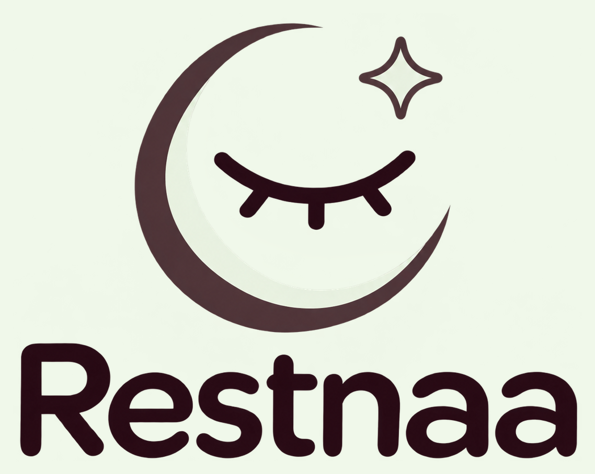
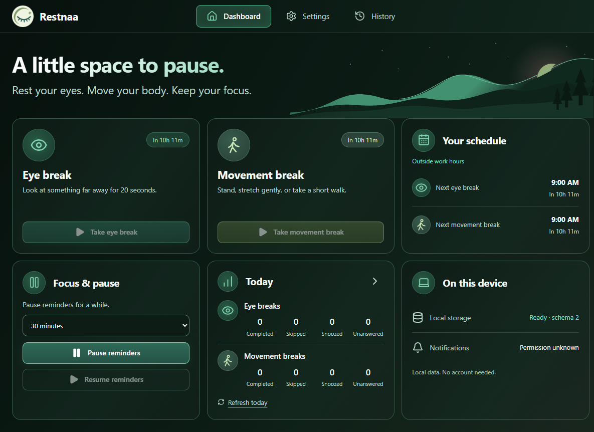
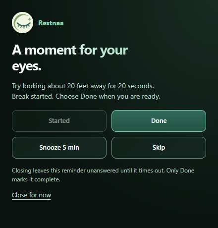
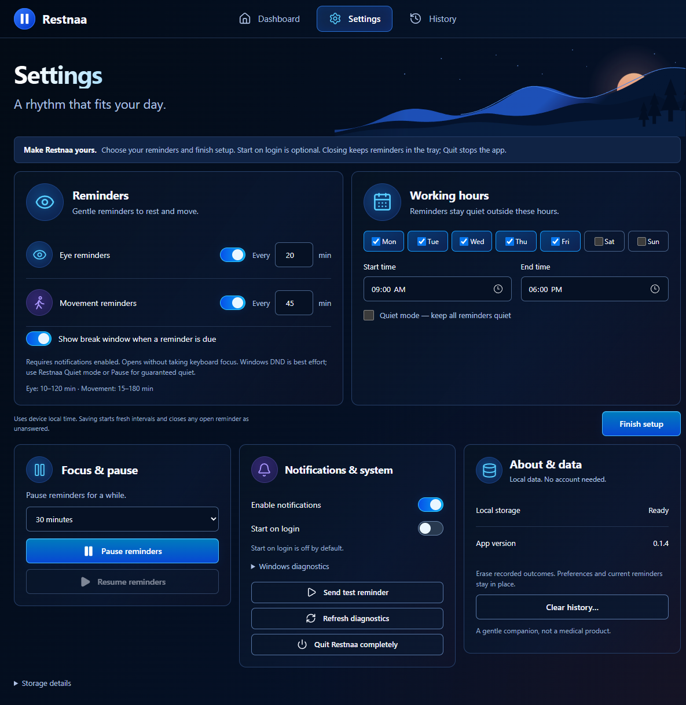
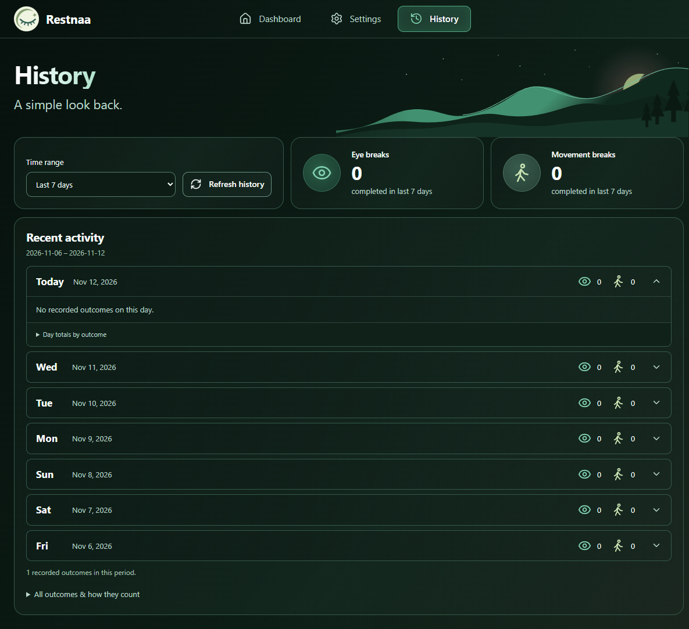

# Restnaa



[Source and issues](https://github.com/restnaa/restnaa)

Contributing? Use a short-lived `feat/`, `fix/` or `docs/` branch and open a pull request to `main`. See the [branch workflow](CONTRIBUTING.md#branch-workflow) and contribution checks.

A quiet, offline Windows desktop app that reminds you to rest your eyes and move.

Restnaa uses Tauri 2, Rust, React, TypeScript, Vite, Tailwind CSS and local SQLite. A single Rust scheduler owns reminders; React displays its typed state. No accounts, cloud sync, analytics, telemetry implementation or medical claims.

**Status: 0.1.4 release candidate.** Contributions are welcome; stable binary release approval is pending. Windows 10/11 are the targets. Clean-machine testing, signing, installed rename/upgrade, startup and notification identity checks remain open. Existing platform limits are documented in [known limitations](docs/KNOWN_LIMITATIONS.md). Source publication is not a claim of production readiness.

## Download the Windows beta

[Get the Windows installer](https://github.com/restnaa/restnaa/releases/tag/v0.1.4-beta.2) and its matching `.sha256` checksum. This is an unsigned pre-release; review the [installation instructions](docs/INSTALLATION.md) and [known limitations](docs/KNOWN_LIMITATIONS.md) before installing.

## What it does

- Independent eye/movement intervals, selected working days/hours and Quiet mode.
- Water reminders default to every 60 minutes, with a separate toggle and interval. This is an adjustable reminder preference, not a medical recommendation or intake target.
- Timed or manual pause, automatic nonactivating break panels and a persistent opt-out.
- Native notifications, tray fallback, close-to-tray, explicit Quit and opt-in startup.
- Done, Snooze, Skip and Unanswered recorded separately in local today/seven-day history.
- First-run configuration in Settings, keyboard controls and reduced-motion support.

Windows DND detection is best effort. Use app Pause or Quiet mode for guaranteed app quiet. Completion records your explicit action; it does not verify exercise or eye rest.

## Screenshots

The light interface uses a pale background with plum accents. Captured from the Windows desktop build of Restnaa 0.1.4. These are actual app views from a local test profile; counts reflect that profile. Captures show the app content without Windows title bars.

### Dashboard



### Break popup

The app's eye-break panel offers Done, Snooze and Skip. This is separate from the native Windows notification banner; Windows banners may be suppressed by Do Not Disturb. A Windows banner capture is not included here.



<details>
<summary>Settings and first-run setup</summary>



</details>

<details>
<summary>Local history</summary>



</details>

## Run on Windows

Install Node.js >=22.12, npm, stable Rust for x86_64-pc-windows-msvc, Visual Studio Build Tools with Desktop development with C++ and a Windows SDK, plus WebView2 Evergreen. See [Tauri prerequisites](https://v2.tauri.app/start/prerequisites/).

From the repository root, in Developer PowerShell for Visual Studio:

```powershell
npm ci
rustup component add rustfmt clippy
npm run tauri dev
```

Use `npm run dev` for frontend preview only. A normal browser cannot run the native scheduler/commands and will show a desktop connection warning. No API key, .env file, backend server or database service is required.

## Test and build

```powershell
npm run lint
npm run typecheck
npm test -- --run --maxWorkers=1
npm run test:ui -- --workers=2
cargo fmt --manifest-path src-tauri/Cargo.toml -- --check
cargo clippy --manifest-path src-tauri/Cargo.toml --all-targets --locked -- -D warnings
cargo test --manifest-path src-tauri/Cargo.toml --all-targets --locked
npm run package:windows
```

UI tests use Microsoft Edge through Playwright, build production assets and inject a test-only IPC bridge. Native behavior requires separate installed Windows testing. Packaging exports an NSIS installer, checksum and docs into ignored `release/`. An absent WebView2 runtime may require an installer prerequisite download. No signing certificate is configured.

## Source map

| Path | Responsibility |
| --- | --- |
| `src/` | Accessible React views, typed commands and event subscriptions |
| `src-tauri/src/scheduler/` | Rust state machine, injectable clock and worker |
| `src-tauri/src/native/` | Notifications, tray, startup and window lifecycle |
| `src-tauri/src/storage/`, `src-tauri/migrations/` | SQLite transaction boundary and migrations |
| `src-tauri/tests/`, `tests/ui/` | Deterministic core and browser workflow tests |
| `docs/` | Policies, architecture, current audit and release gates |

## Local data

Restnaa stores its local SQLite database at `%APPDATA%\com.restnaa.desktop\restnaa.sqlite3`. Its application identifier is `com.restnaa.desktop` and its executable is `restnaa.exe`.

This is a fresh pre-release identity. No automatic migration from earlier development profiles is performed. Existing local test data is left untouched. Quit other development builds before testing a new candidate. Corrupt databases fail visibly and are never silently replaced.

See [privacy](PRIVACY.md), [installation](docs/INSTALLATION.md), [scheduler contract](docs/SCHEDULER.md). The app implements no network calls; embedded WebView2/Windows component traffic remains a separate audit boundary. A strict zero-egress guarantee is not established.

## Contribute

Start with [CONTRIBUTING.md](CONTRIBUTING.md) and [repository instructions](AGENTS.md). Bug reports, documentation, accessibility, tests and small fixes are welcome. Product boundaries are documented in the repository instructions. Please discuss behavior changes before building them; AI, accounts, cloud sync, payments and employee monitoring are outside the current product scope.

See [security reporting](SECURITY.md), [community guidelines](CODE_OF_CONDUCT.md), [MIT license](LICENSE) and [third-party notices](THIRD_PARTY_NOTICES.md). Exact earlier internal audit evidence remains in Git history; it does not certify the current identity.
